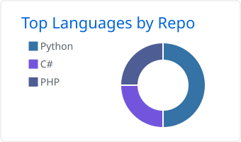
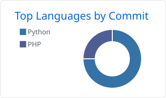
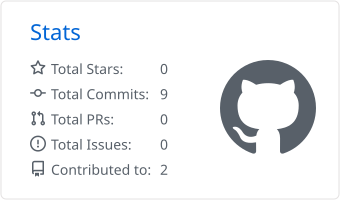

## Olá! Eu sou Rômulo Pardini 👋

Estudante de **Big Data para Negócios** na **FATEC** (2º semestre), com interesse em transformar dados em decisões.
Atualmente estou em busca de **estágio em Dados / Analytics**.

### 🔭 O que estou fazendo agora
- Aprendendo **Python** com projetos práticos, como o [Controle de Gastos](https://github.com/rPardini13/controle-gastos)
- Estudando bancos de dados **SQL** e **NoSQL**

### 🛠️ Ferramentas
`Python` · `SQL` · `NoSQL` · `HTML/CSS` · `PHP` · `C#` · `Git`

### 📂 Projetos em destaque
| Projeto | Descrição | Tecnologias |
|---|---|---|
| [controle-gastos](https://github.com/rPardini13/controle-gastos) | Controle de gastos pessoais no terminal | Python |
| [ProjetoLeviathan](https://github.com/rPardini13/ProjetoLeviathan) | Site acadêmico | HTML, PHP, CSS |

### 📊 Estatísticas
<picture>
  <source media="(prefers-color-scheme: dark)" srcset="https://raw.githubusercontent.com/rPardini13/rPardini13/main/profile-summary-card-output/github_dark/1-repos-per-language.svg" />
  
</picture>
<picture>
  <source media="(prefers-color-scheme: dark)" srcset="https://raw.githubusercontent.com/rPardini13/rPardini13/main/profile-summary-card-output/github_dark/2-most-commit-language.svg" />
  
</picture>
<picture>
  <source media="(prefers-color-scheme: dark)" srcset="https://raw.githubusercontent.com/rPardini13/rPardini13/main/profile-summary-card-output/github_dark/3-stats.svg" />
  
</picture>

### 🐍 Contribuições
<picture>
  <source media="(prefers-color-scheme: dark)" srcset="https://raw.githubusercontent.com/rPardini13/rPardini13/output/github-snake-dark.svg" />
  
</picture>

### 📫 Contato

